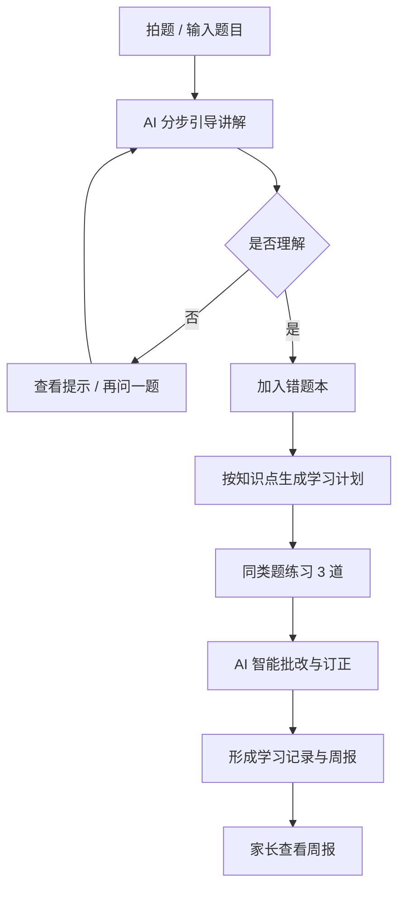
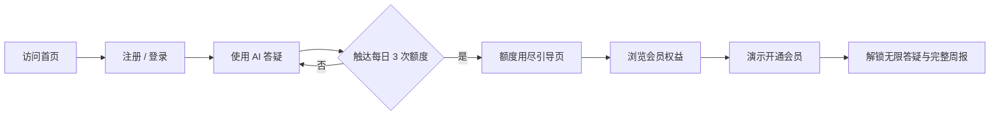

# AI 学习助手 · 产品需求文档（PRD）

> 版本：v1.0 ｜ 作者：Fee ｜ 状态：Demo 版本
> 一句话定位：面向 K12 学生的 AI 引导式学习助手，用「先思考、再看答案」的方式把一道题真正讲透，并沉淀为错题、计划与家长周报。

## 1. 背景与目标

### 1.1 背景

K12 学生在课后作业中普遍存在「不会做、没人讲、讲了也不懂」的问题。传统搜题工具直接给答案，短期提分、长期损伤独立思考能力；家长想了解孩子的学习状态，却只能看到「做了几道题」，缺少可行动的过程数据。

本产品以「引导式讲解」为核心，把一次提问拆成可逐步展开的思考路径，并将错题自动转化为复习计划，最终形成「学生学、家长看、运营调」的完整闭环。

### 1.2 产品目标

- 学生目标：从「抄答案」转为「跟着步骤想」，单题平均理解时长 ≥ 3 分钟。
- 家长目标：用一份可读的周报回答「孩子这周学得怎么样、我能帮什么」。
- 商业目标：以免费额度建立使用习惯，通过会员权益完成轻量转化。
- 数据目标：AI 讲解完读率 ≥ 60%，7 日留存 ≥ 35%，免费转付费 ≥ 3%。

### 1.3 能力覆盖总览

| 能力维度 | 本产品的体现 |
| --- | --- |
| 教育产品理解 | 引导式讲解、错题归类、复习计划、家长周报完整闭环 |
| AI 产品设计 | Prompt 设计原则、幻觉兜底、内容安全、AI 质量指标 |
| 数据分析能力 | 北极星指标、AARRR 漏斗、留存与转化看板、A/B 实验设计 |
| 用户研究 | 学生 / 家长 / 运营三类 Persona 与场景痛点拆解 |
| 商业与增长 | 免费额度、会员权益对比、套餐与转化路径设计 |
| 文档与协作 | 本 PRD、可交互 Demo、运营看板与跨端一致性 |

## 2. 用户画像

### 2.1 学生 · 林小雨（初一）

- 年龄与场景：12 岁，初一，每天 19:00–21:00 写作业，遇到难题习惯先拍照搜题。
- 痛点：答案看懂了但换个数字就不会；错题散落在试卷和截图里，复习没有重点。
- 诉求：有人一步步带着想；错题能自动整理；练习不要太多，但要真的有用。

### 2.2 家长 · 林女士（38 岁）

- 年龄与场景：职场妈妈，每周只能抽出零散时间了解孩子学习，主要在周末查看总结。
- 痛点：不知道孩子卡在哪里；直接问容易引发对抗；报班与买课缺少判断依据。
- 诉求：一份说人话的周报；明确的薄弱点与陪伴建议；看到投入是否有效。

### 2.3 运营 · 王同学（26 岁）

- 年龄与场景：教育产品运营，负责拉新、留存与会员转化，每天关注转化漏斗。
- 痛点：不知道用户在哪一步流失；活动与文案调整缺少数据依据。
- 诉求：实时可看的漏斗与分群数据；能快速发起 A/B 实验并复盘。

## 3. 核心用户流程

### 3.1 学生端学习闭环

### 3.2 会员转化路径

## 4. 功能清单与优先级

| 模块 | 功能 | 优先级 | 说明 |
| --- | --- | --- | --- |
| 作业辅导 | 文字输入 / 模拟拍题 | P0 | 降低提问门槛，拍题先做识别动画的演示降级 |
| AI 答疑 | 分步引导讲解 | P0 | 3–5 步，每步含标题、内容与引导反问 |
| AI 答疑 | 来源标签与加载态 | P0 | 标注「AI 实时生成 / 示例回答」，骨架屏降低等待焦虑 |
| AI 答疑 | 查看答案默认折叠 | P0 | 先思考后核对，防止直接抄答案 |
| 错题本 | 按知识点归类与掌握率 | P0 | 支持展开讲解、标记掌握、重做、删除 |
| 错题本 | 一键加入错题本 | P0 | 从讲解页与批改结果均可加入，自动去重 |
| 学习计划 | 错题驱动任务生成 | P0 | 每个知识点生成复习与同类题练习，固定每日一读 |
| 学习计划 | 任务勾选与进度环 | P1 | 完成后自动同步进度 |
| 同类题 | AI 生成 3 道变式题 | P1 | 加载骨架屏，失败可重试 |
| AI 批改 | 得分、对错、点评与订正 | P0 | 逐题批改，全部完成后输出学习建议 |
| 学习报告 | 家长周报 | P1 | 指标卡、图表、薄弱点、AI 鼓励与建议 |
| 学习报告 | 学习记录沉淀 | P2 | 练习记录进入首页最近记录与周报 |
| 会员 | 权益对比与套餐选择 | P0 | 月 / 季 / 年三档，季卡推荐、年卡最划算 |
| 会员 | 模拟支付与状态切换 | P1 | 演示环境不产生真实扣费，可恢复免费版 |
| 运营后台 | 数据看板与漏斗 | P2 | 时间范围切换、留存、转化漏斗、洞察建议 |
| 内容安全 | 敏感内容与作弊拦截 | P0 | 识别到直接索要答案时先给引导，必要时拒绝 |

## 5. AI 方案与风险

### 5.1 引导式讲解 Prompt 设计原则

1. **角色设定**：资深 K12 学科老师，语气耐心、具体、不堆砌术语。
2. **结构约束**：只输出 JSON，包含 `steps`（3–5 步）、`knowledge`、`answer`、`source`。
3. **先引导后结论**：每步先讲「为什么」，再给 `hint` 反问，答案单独放在 `answer` 字段。
4. **分层提示**：从识别题型 → 回忆方法 → 应用计算 → 检验反思，避免一步到位。
5. **学科适配**：数学强调步骤与依据，语文强调文本证据，英语强调语法规则与语境。
6. **可读性**：单步不超过 120 字，使用短句，避免一次抛出多个新概念。

### 5.2 防止直接抄答案

- 答案默认折叠，必须完成全部步骤后才能展开。
- 学生输入「直接告诉我答案」时，返回引导式提示而非最终结果。
- 讲解过程记录展开行为，完读率作为 AI 质量指标。
- 家长端只展示过程与掌握度，不展示可复制的整卷答案。

### 5.3 幻觉与兜底策略

- 服务端对模型输出做 JSON 解析与字段校验，失败自动重试一次。
- 超时 25 秒或解析失败时，回退到高质量预置样例，并标注「示例回答」。
- 知识点与题目命中预置库时优先使用人工校对内容，保证核心体验稳定。
- 前端对空字段做兜底，避免出现空白步骤或断裂页面。

### 5.4 内容安全

- 对暴力、成人、隐私泄露等输入做前置过滤，命中后返回安全提示。
- 不收集真实姓名、学校、联系方式等敏感信息，演示数据均为虚构。
- 家长周报仅呈现学习行为，不对孩子做人格化评价。
- AI 建议使用鼓励性表达，避免制造焦虑或比较排名。

## 6. 数据指标体系

### 6.1 北极星指标

**周有效学习题数**：一周内完成「讲解 + 至少一次练习或错题复习」的题目数。它同时反映使用深度与学习闭环完成度。

### 6.2 AARRR 漏斗指标

| 阶段 | 指标 | 目标 |
| --- | --- | --- |
| Acquisition | 首页访问 → 注册转化率 | ≥ 55% |
| Activation | 首日完成一次 AI 讲解 | ≥ 70% |
| Retention | 次日 / 7 日留存 | ≥ 45% / 35% |
| Revenue | 免费 → 付费转化率 | ≥ 3% |
| Referral | 家长周报分享率 | ≥ 12% |

### 6.3 AI 质量指标

- 讲解满意度：讲解页「有帮助」点击率。
- 完读率：展开全部步骤的用户占比。
- 二次追问率：同一题目继续追问的比例，反映是否真正理解。
- 批改一致率：人工抽检与 AI 判分一致的比例，目标 ≥ 90%。
- 平均首响时长：目标 ≤ 8 秒，超时自动兜底。

### 6.4 会员转化指标

- 额度触达率、额度页 → 会员页转化率、套餐点击率、支付成功率。
- 会员 30 日续费率与会员用户周有效学习题数。
- 按来源拆分：自然触达、额度引导、周报升级位。

### 6.5 实验计划（A/B）

| 实验 | 变量 | 假设 | 观测指标 |
| --- | --- | --- | --- |
| 免费额度 | 每日 3 次 vs 5 次 | 5 次提升留存但降低转化 | 7 日留存、转化率、ARPU |
| 引导文案 | 「继续提问」vs「解锁完整讲解」 | 强调损失感提升点击 | 会员页到达率、开通率 |
| 套餐排序 | 季卡优先 vs 年卡优先 | 年卡优先提升客单价 | 套餐选择分布、GMV |

## 7. 里程碑与迭代规划

| 阶段 | 时间 | 范围 | 验收标准 |
| --- | --- | --- | --- |
| M1 核心闭环 | 第 1–2 周 | 提问、分步讲解、加入错题本 | 主流程可完整走通，来源标签正确 |
| M2 练习与计划 | 第 3–4 周 | 同类题、AI 批改、错题驱动计划 | 批改结果可沉淀，计划自动生成 |
| M3 家长与会员 | 第 5–6 周 | 周报、权益对比、模拟支付 | 家长端数据可读，会员状态可切换 |
| M4 数据与文档 | 第 7 周 | 运营看板、PRD、埋点方案 | 看板可切换周期，指标口径清晰 |
| M5 真实上线 | 第 8 周起 | 账号体系、真实支付、内容审核 | 通过安全与合规评审 |

## 8. 开放问题

1. 免费额度按「提问次数」还是「讲解步数」计算更合理？
2. 拍题识别依赖第三方 OCR，准确率与成本如何平衡？
3. 家长周报是否需要支持多孩子账号与家庭成员共享？
4. 错题「已掌握」由学生自评还是由重做结果自动判定？
5. AI 批改在主观题（作文、阅读理解）上的评分标准如何校准？
6. 会员定价在低线城市是否需要区域化或校园团购方案？
7. 如何在提升转化的同时，避免对未成年用户形成过度付费诱导？
