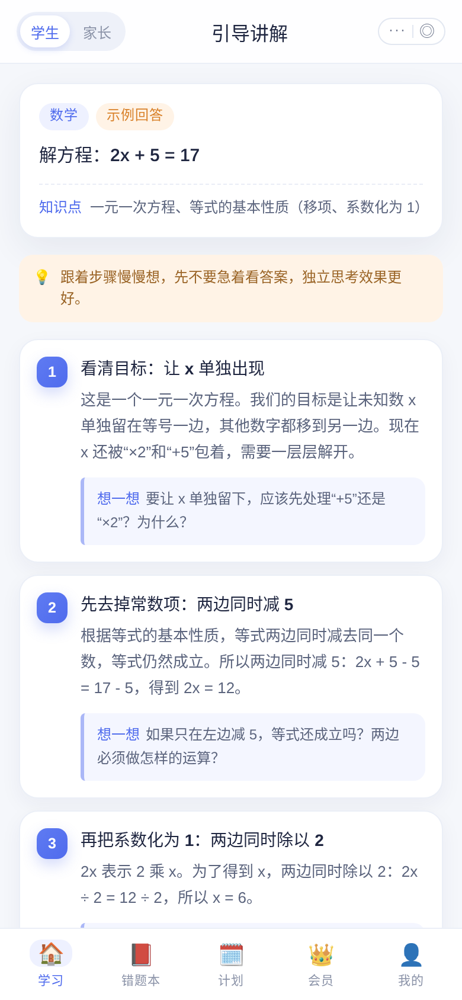
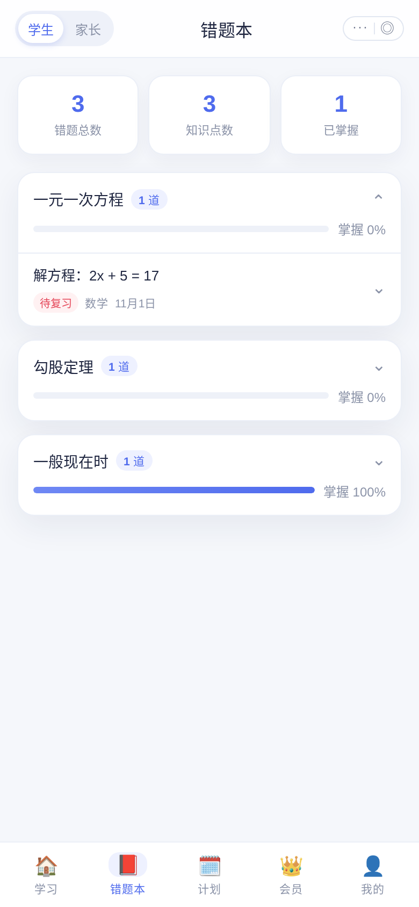
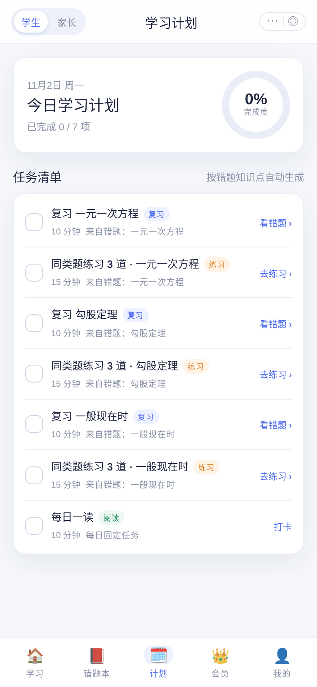
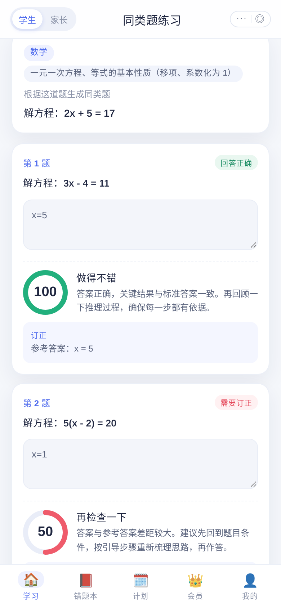
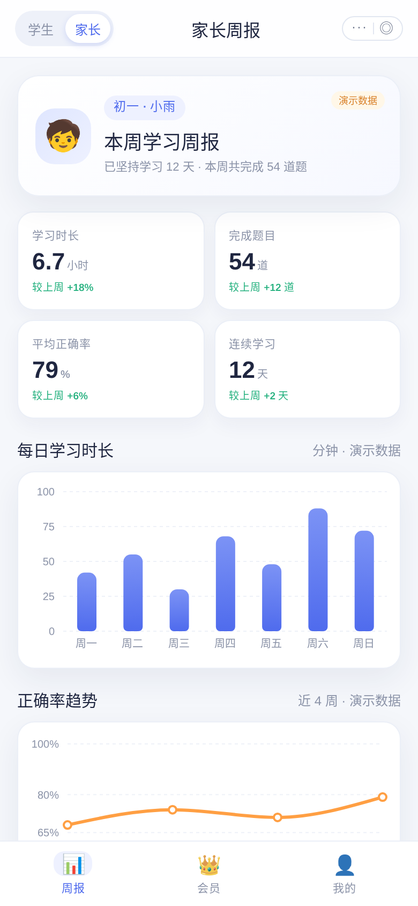
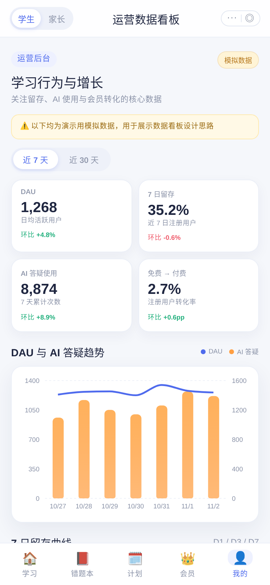

# AI 学习助手 · 教育行业产品经理作品集 Demo

一个面向 K12 场景的移动端 AI 学习助手原型（微信小程序风格 H5），用于展示教育行业产品经理在**需求拆解、AI 方案设计、学习闭环、商业化与数据运营**上的完整思考。

从「拍题提问」到「AI 分步讲解 → 错题本 → 学习计划 → 同类题练习 → AI 批改」，再到「家长周报、会员转化、运营看板」，所有关键路径均可真实点击体验。

**在线体验：** https://feiw3440-cell.github.io/edu-ai-demo/

> 纯前端静态部署时，AI 请求由浏览器直接调用免密钥接口；网络异常会自动回退到本地预置的高质量示例回答，演示不会中断。

## 功能列表

- **学生端学习闭环**
  - 首页支持数学 / 语文 / 英语选科、题目输入、模拟拍题识别与示例题快捷填充
  - AI 引导式分步讲解：逐步展开、每步附「想一想」反问，答案默认折叠，避免直接抄答案
  - 一键加入错题本，按知识点自动归类；支持标记已掌握、重做、删除
  - 根据错题知识点自动生成今日学习计划，任务可勾选完成并显示进度
  - 同类题练习：3 道变式题 + AI 逐题批改，展示得分、点评与订正
  - 免费用户每日 3 次 AI 答疑，额度用尽后引导至会员页
- **家长端周报**
  - 孩子学习概览、每日学习时长柱状图、正确率趋势折线图
  - 薄弱知识点 Top3、AI 鼓励与家庭陪伴建议，并融合错题本真实数据
- **会员与商业化**
  - 免费版 / 会员权益对比、月卡 / 季卡 / 年卡套餐选择
  - 模拟支付确认（明确提示演示环境、不产生扣费），支持恢复免费版
- **运营数据看板**
  - 近 7 天 / 近 30 天切换，DAU、留存、AI 使用、付费转化等指标与趋势图
  - 免费 → 付费转化漏斗、PM 视角洞察与行动建议（数据为固定伪随机模拟）
- **产品文档**
  - 应用内直接渲染 `PRD.md`，含核心流程图与完整产品方案

## 截图

| AI 分步讲解 | 错题本 |
| --- | --- |
|  |  |

| 学习计划 | AI 批改 |
| --- | --- |
|  |  |

| 家长周报 | 运营数据看板 |
| --- | --- |
|  |  |

## 技术栈

- **前端：** React 19 + Vite，原生 CSS（无 UI 库、无 TypeScript、无 react-router）
- **图表：** Recharts
- **后端：** Express（ESM），提供 `/api/explain`、`/api/grade`、`/api/similar`、`/api/health`
- **AI：** 调用免密钥的 [text.pollinations.ai](https://text.pollinations.ai)，要求模型返回 JSON，失败自动回退预置样例
- **部署：** GitHub Pages 官方 Actions 工作流（静态模式）

## 本地运行

```bash
npm install

# 静态模式（纯前端，构建产物在 dist/）
npm run build:pages
npm run preview

# 后端模式（Express 同时托管前端与 API，默认 http://localhost:3001）
npm run build
npm start

# 开发模式：终端 A 启动后端，终端 B 启动 Vite（/api 代理到 3001）
npm run server
npm run dev
```

其他脚本：`npm run lint`（oxlint）、`node scripts/e2e.mjs http://localhost:3001`（Playwright 端到端检查）。

## 真实与模拟说明

- **真实 AI：** 自定义题目的讲解、同类题生成与批改，会调用免密钥的 `text.pollinations.ai`。请求超时 20 秒，失败或 JSON 解析失败时自动回退到示例回答，并在界面标注来源（「AI 实时生成」/「示例回答」）。
- **预置样例：** 覆盖 K12 数学、语文、英语共 9 道典型题，包含分步讲解、知识点、答案与同类题。
- **模拟数据：** 支付流程（演示环境，不产生任何扣费）、家长周报、运营数据看板均为模拟数据，仅用于产品演示。

## 产品文档

完整需求背景、用户画像、核心流程、功能优先级、AI 方案与风险、数据指标体系与迭代规划见 [PRD.md](PRD.md)，也可在应用内「我的 → 产品需求文档 PRD」查看。
